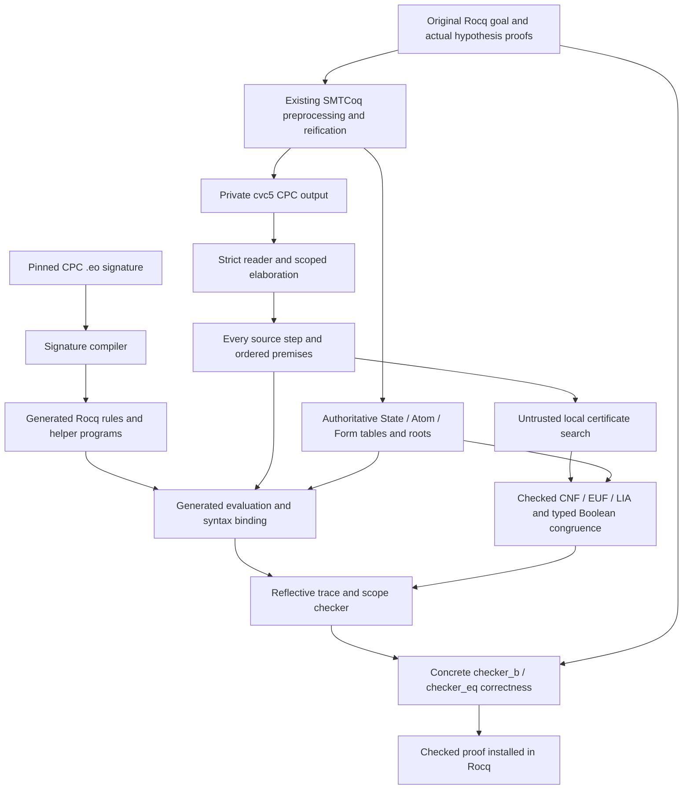

# cvc5 / Eunoia development backend

`cvc5_eunoia` exports a reified Rocq goal to the private cvc5 solver, reads its
CPC proof, evaluates every inference through a signature-generated Rocq
interpreter, checks a semantic certificate for every inference, and applies a
proved goal-checker correctness lemma. It uses SMTCoq's existing SMT-LIB
interpretation and CNF/EUF/LIA checkers.

The functional suites contain 23 public UF proofs, 11 additional Boolean UF
proofs and 17 integer/mixed proofs, plus seven purification/constant/multi-goal regressions and 12 integer-cut proofs,
with false-goal and corrupted-proof controls. They have passed compilation and
baseline assumption audits. The recorded benchmark checkpoints retain compiler timeouts in their coverage
denominators. This is an experimental backend, with explicitly
bounded coverage and no competitive performance claim.

The [current development progress](backend-progress-2026-11-04.md) records
new coverage, independent proof checks and the matched benchmark, including
remaining failures and performance gaps.

## Build and use

Activate an OCaml/Rocq toolchain (Rocq 9.2 or newer, Dune 3.21 or newer,
Python 3.9 or newer), then run from the repository root:

```sh
python3 -B scripts/eunoia/install_toolchain.py
dune build --ignore-promoted-rules -j2 theories
sh scripts/eunoia/ci.sh
```

The solver runner uses pinned cvc5 1.4.2 from the same private cache as the
installer, independently of older PATH solvers. See the
[installer and verifier](../../scripts/eunoia/README.md) for checksum pins and
`EUNOIA_TOOLCHAIN_ROOT`. `EUNOIA_ENV` selects an optional command wrapper for
profiling/audits; the default uses the activated toolchain, with no private
machine paths. The pinned release currently supports Linux x86-64.

```coq
From SMTCoq Require Import SMTCoq.
From Stdlib Require Import ZArith.
Local Open Scope Z_scope.

Lemma congruence :
  forall (A : Type) (HA : CompDec A) (f : A -> A) (x y : A),
    x = y -> f x = f y.
Proof. cvc5_eunoia. Qed.

Lemma bounds (x : Z) : x <= 0 -> x >= 1 -> False.
Proof. cvc5_eunoia. Qed.
```

Ordinary local hypotheses are included by the existing preprocessing. The
solver-specific tactic also accepts supplied hypotheses, for example
`cvc5_eunoia (Hxy, Hyz)`. Every uninterpreted carrier, including intermediate
function-result sorts, needs an existing `CompDec` instance. The tactic reuses
those proof terms and rejects unresolved instance cuts.

The default `smt` strategy is unchanged. The new backend is selected explicitly
with `cvc5_eunoia`.

## Signature generation

The committed signature is cvc5 1.4.2's complete 35-file CPC include closure.
The compiler follows its declarations, patterns, binder types, ordered helper
cases, requirements, aliases and computed conclusions. Selection in
`tools/eunoia/rules.txt` currently includes 87 rules and 59 helpers; the manifest
lists all source hashes and 524 excluded rules. There is no rule-name-dependent
execution switch implementing the selected CPC inferences.

```sh
python3 tools/eunoia/regenerate.py
EUNOIA_KEEP_TEST_DIR=1 tools/eunoia/check-generated.sh
```

Regeneration updates `theories/checker/eunoia/CpcGenerated.v` and
`tools/eunoia/cpc-manifest.json`. Validation checks deterministic regeneration,
48 Python tests, source/helper/guard mutations, all 1,158 steps in 32 actual
original/reduced solver captures, and independent kernel checks. These fixture
replays establish source computation coverage; semantic proof acceptance uses
the additional gate described below. See the [compiler interface](../../tools/eunoia/INTERFACE.md)
and [integer-tightening capture](../../tools/eunoia/STRICT-SHIFT-VALIDATION.md).
The [integer-cast captures](integer-cast-signature-coverage.md) add generated
parity/coefficient-bound computations, including nested scopes. The live tactic now accepts restricted rational intermediates through an
integer representation: positive-denominator cross products, exact closed floors,
and integral cast round trips. Free Real terms and non-ground fractional floors
remain unsupported. See [integer embedding](integer-embedding.md). Source-declared polymorphic operators are
generated metadata; distinct applications may use distinct type instances.

The runtime's argument-conversion optimization has a pointwise refinement proof
for arbitrary fuel, nil/type queries, operator lists and terms. Both lemmas are
closed under the global context, and
`tools/eunoia-runtime-profile/SurfaceOutRefinement.vo` is a normal build/test target.

## Checked data flow



The strict reader resolves visible premise identities and rejects future,
missing and expired references. Every source command is processed, including
unused steps and steps following a conflict. Roots come from the actual goal
and hypothesis proof terms. The source assumptions must match their ordered
export or its stable first-occurrence projection for duplicate assertions;
all authoritative roots and root claims remain in the checker.

`EunoiaAdapter` binds each ordered premise and result to the authoritative
tables and reruns the actual generated rule computation. N-ary integer `+`/`*`
use a checked deterministic right-fold representation preserving operand order,
duplicates and existing binary subtrees. Explicit negations and signed literal
spellings remain represented. See the [exact binding contract](adapter-interface.md).

For each inference, a checked local certificate refutes the exact premise
clauses plus negated conclusion. It preserves disjunctive premises, checks live
reads, bounds, fresh outputs and every expected intermediate clause, and
rejects failure fallbacks. Candidate search cannot authorize a clause. The
scoped checker uses the actual pushed literal and endpoint, checks the guarded
consequence, and restores parent state so local facts expire. See
[the local gate](local-certificate.md) and [the scoped backend](scoped-backend.md).

Typed Boolean UF congruence reuses the same Atom/Form interpretation. It checks
the actual endpoint types before turning positive Boolean `Fiff` operands into
conditional atom equalities. Default Boolean projection of a non-Boolean value
cannot supply this evidence. Existing checked resolutions discharge the equality
conditions. See [the Boolean UF integration](boolean-uf-integration.md) for the
contracts, public proofs, mutations and remaining source-format gaps.

The fixed concrete correctness wrappers use the existing interpretation.
Within each tactic invocation, Rocq synchronously kernel-checks a private proof
that the complete applied checker returns `true`. The tactic reuses that checked
proof through Rocq's abstraction API, then installs the complete correctness
application with `Tactics.exact_check`. All private proof creation is part of
tactic time. Failed and undone attempts must restore the original proof state.
The optional [generated-helper cache](helper-cache.md) additionally proves
reference-evaluator refinement and validates all helper hints before reuse.
It is experimental and disabled by default pending full tactic measurements.

See [the certificate-reuse report](checked-certificate-reuse.md) for the API,
rollback controls and saved-body audits. `Qed` and independent `rocq check`
validate the saved term. Parser success, an `unsat` answer,
native search success and generated syntax computation are not proof acceptance.

## Evidence and limits

Current commands, revision pins and remaining milestones are recorded in
[the implementation plan](implementation-plan.md). The [UF report](uf-live-coverage.md)
and [LIA report](lia-live-coverage.md) retain exact public proof and rejection
commands. Completed audits have introduced no dependencies beyond the existing
52-name baseline: 51 primitive-integer operations/specifications and
`ProofIrrelevance.proof_irrelevance`. The exact names are in
`baseline-assumptions.txt`; this is not an axiom-free claim.

The [benchmark harness](../../benchmarks/eunoia/README.md) counts only completed
proofs whose assumption reports match that baseline. It retains tactic, `Qed`
and whole-compiler times, timeouts, raw diagnostics and toolchain provenance.
Final comparisons must use the same integrated revision and workload. Published
[Lean-SMT and Sledgehammer context](comparison-context.md) uses different goals,
versions and timing boundaries; it supplies no speed ratio for this backend.

Known limits include excluded source rules, finite generation/search budgets,
higher-order purification and Boolean-constant cases outside the default local-equality normalization, and proofs requiring
object-level Real/`to_real`/`to_int` intermediates. Rational/decimal metadata
support does not add real-arithmetic semantics. Bitvectors, arrays and other
theory extensions are outside this UF/LIA change.

## Producer sharing and source-preserving scopes

The frontend shares immutable marshaled syntax and repeated generated candidates
within one preparation. The public tactic may reuse successful local witness
candidates only for identical ordered clauses in the same Atom/Form tables.
Caches are bounded and never store a proof-acceptance Boolean; the final applied
checker still evaluates and semantically gates every source occurrence, including
unused steps. No candidate is shared across unrelated goals or proof contexts.

For matched producer ablations, set `EUNOIA_DISABLE_TERM_CACHE=1`,
`EUNOIA_DISABLE_DERIVE_CACHE=1`, and `EUNOIA_DISABLE_WITNESS_CACHE=1`. The benchmark
records these switches and fingerprints the source and loaded proof/plugin
artifacts before and after measurement; changed checkers invalidate the run.
These producer optimizations do not memoize the trusted generated evaluator's
side-condition execution.

Purification keeps raw `@purify` syntax for generated computation and uses its
original term only in the checked table-binding view. Scoped payloads retain the
raw pushed assumption: its binding to the actual pushed literal is checked
before generated discharge. The local gate still proves the exact guarded
consequence, and parent-state restoration remains unchanged. The ordinary payload
constructor remains compatible; ordinary steps reject scope-only metadata.

The public tactic normalizes local Boolean variable equalities with `true`/`false`
using kernel equality elimination before capturing local hypotheses. Explicitly
supplied lemmas keep their original context. This avoids the legacy reifier's
formula-versus-atom assertion for the tested constant-argument goals. It does not
provide a general Boolean-formula-as-UF-argument representation.

The backend selects the proved `EunoiaMemo` wrapper when at least four local
certificate validations can be shared and at least a quarter of source steps
reuse an exact certificate. Otherwise it retains the original representation.
This is a conservative producer heuristic, not a measured performance guarantee.
Up to 512 exact certificate entries are validated once, including
unused entries. Each source occurrence must still pass generated rule
evaluation, exact syntax binding, bounds/freshness/liveness checks, and an exact
ordered-premise/conclusion match to its selected entry. Remaining certificates
use the original inline semantic gate. The reference wrappers remain available
with `EUNOIA_DISABLE_CHECKED_CACHE=1`. Set `EUNOIA_FORCE_CHECKED_CACHE=1`
to exercise sharing regardless of repetition; disable takes precedence. No
checking is disabled by these switches. Fresh reference and forced-shared
proofs, including corruption controls, are independently kernel checked by
`scripts/eunoia/check_modes.py` in CI.

`EunoiaMemo.gate_correct` and its scoped/Boolean/equality correctness wrappers
are proved in Rocq from the existing local gate and scope theorems. Cache
entries contain certificate data, never caller-provided acceptance Booleans or
new semantic assumptions. The regression suite rejects corrupted unused entries,
wrong references, changed conclusions, reordered premises, invalid inline
certificates and unsupported generated rules.

Set `EUNOIA_CACHE_PROFILE=1` to record preparation counts (source steps, shared
entries, inline certificates and sharing hits). Counts describe producer data; successful
`Qed`, assumption audits and independent kernel checks remain the acceptance
criteria. `python3 -B scripts/eunoia/check_proofs.py` audits the correctness
boundary and all exported public Eunoia theorem suites against the inherited
52-name baseline, then recursively checks the saved proofs independently.

The backend also supports [proved facts for Rocq integer division and modulo](division.md)
through its existing UF/LIA semantics. The separate benchmark manifest retains
signed/zero cases and false controls without changing the original workload.
